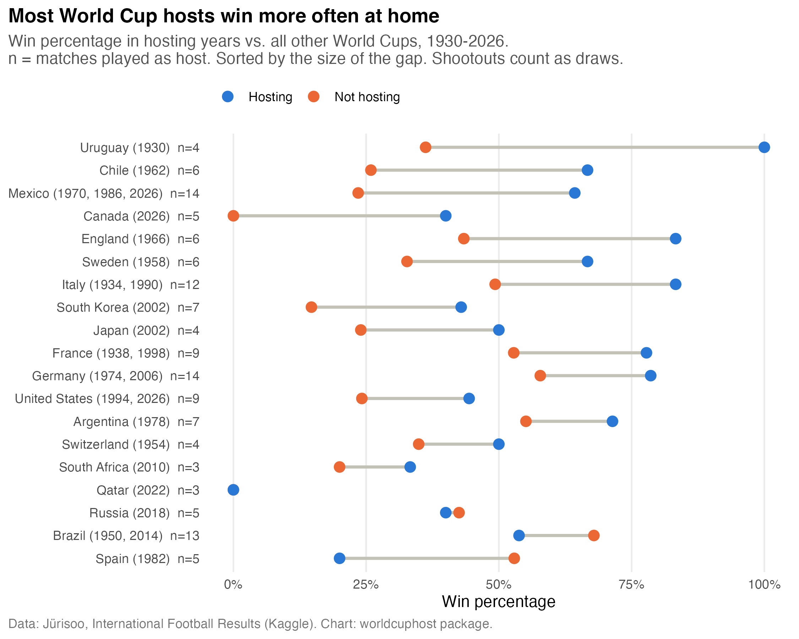

# worldcuphost

Do countries play better when they host the FIFA World Cup? `worldcuphost` is an R package for measuring home advantage at the men's World Cup. It compares how each host nation performs in the tournaments it hosted with how it performs in all other World Cups.

## Installation

```r
# install.packages("devtools")
devtools::install_github("Gopeeks/worldcuphost")
```

## What's included

| Item | What it does |
|---|---|
| `world_cup_matches` | Every men's World Cup match, 1930-2026 (1,068 matches, 9 variables) |
| `get_host_years(country)` | Years in which a country hosted at least one World Cup match. Co-hosts (2002, 2026) count for each host. |
| `host_performance(country)` | Matches, win percentage, and goals per game when hosting vs. not hosting |

## Example

```r
library(worldcuphost)

get_host_years("Brazil")
#> [1] 1950 2014

host_performance("Brazil")
#>    hosting matches win_pct goals_per_game
#> 1     Host      13    53.8           2.54
#> 2 Not host     106    67.9           2.02
```

## Early results



Across all 19 host nations, teams won 61.0% of their matches as host (83 of 136) and 44.8% of their other World Cup matches (432 of 965). 15 of the 19 hosts had a higher win rate at home. The chart is produced by `analysis/host_advantage_chart.R`.

## In progress

- `stage_reached(country, year)`: how far a team got in a given tournament
- `plot_host_advantage(country)`: a built-in version of the chart above
- testthat test suite and a vignette

## Data sources

- Jürisoo, Mart. "International Football Results from 1872 to 2026." Kaggle. <https://www.kaggle.com/datasets/martj42/international-football-results-from-1872-to-2017>
- Gower, Evan. 2022. "FIFA World Cup." Kaggle. <https://www.kaggle.com/datasets/evangower/fifa-world-cup> (planned, for tournament stage)

Penalty shootouts count as draws, because the match data records only goals scored in regular and extra time.
